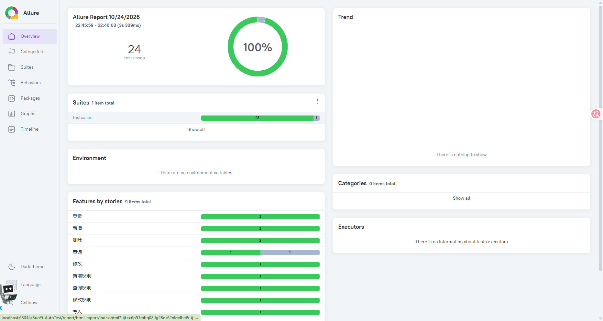
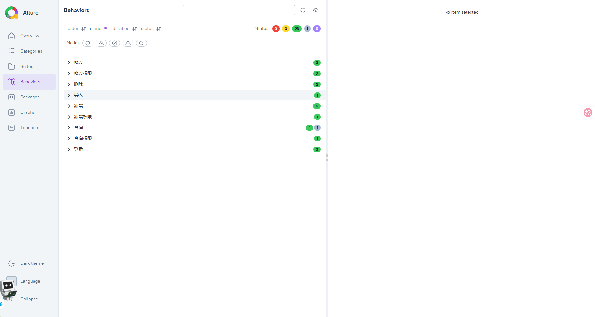
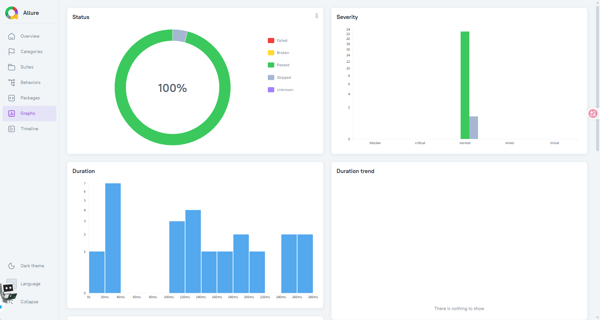
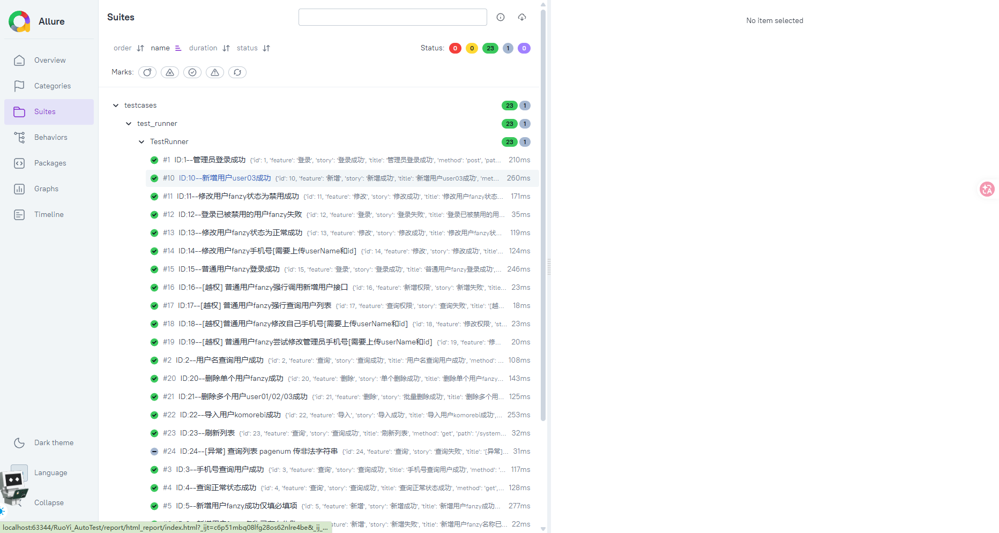
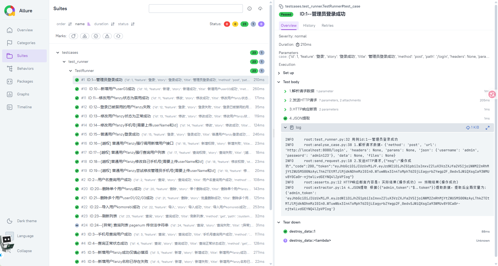

# RuoYi-Api-AutoTest · 若依后台管理系统接口自动化测试

[](https://github.com/fanzyx007-hash/RuoYi-Api-AutoTest/actions/workflows/api-test.yml)


基于 **Pytest + Excel 数据驱动** 的接口自动化测试框架，对 [若依 RuoYi-Vue](https://gitee.com/y_project/RuoYi-Vue) 后台管理系统的**登录、用户管理、权限控制**链路做端到端验证，并对登录链路做过 JMeter 压测与瓶颈定位。

## 数据速览

| 指标 | 数值 |
|---|---|
| 自动化用例 | **24 条**（23 通过 + 1 条已确认缺陷 `xfail`） |
| 覆盖范围 | **6 个模块 / 7 个接口**（登录、查询、新增、修改、删除、导入、越权） |
| 单次全量回归 | **约 5.8s**（本地，含数据库造数与清理） |
| 断言方式 | HTTP 响应断言 + **PyMySQL 数据库断言** 双通道 |
| 压测结论 | 50 并发 TPS 50.13、P95 1.73s、错误率 0%，**拐点约 30 并发** |

**三个特点**

- **数据驱动**：用例写在 Excel 里（19 列 schema），加用例不改代码，非开发同学也能维护；
- **双通道断言**：不只校验 HTTP 响应，还用 PyMySQL 直连数据库校验落库结果，能抓出"响应 200 但数据没落库"的假通过；
- **接口依赖自动传参**：登录拿 token、新增取 `userId`，通过 JSON 提取 / SQL 提取 + Jinja2 模板渲染注入后续用例，用例之间**零硬编码**。

---

## 测试报告

### 总览：24 条用例，通过率 100%



> 1 条 `xfail` 为**已确认缺陷**（用户列表 `pageNum` 传非法字符串仍返回 200），不计入失败，用于避免已知问题污染回归信号。

### 按功能模块分组（Behaviors）



### 状态分布与耗时分布



### 用例明细（Suites）



### 单条用例执行步骤与断言日志



每条用例在 Allure 里都能看到 **解析数据 → 发送请求 → HTTP 断言 → JSON 提取** 四个 step，以及实际请求体、响应体与提取到的变量，失败时能直接定位到是参数问题、断言问题还是环境问题。

---

## 技术栈

| 分类 | 选型 |
|---|---|
| 测试框架 | Pytest（参数化 + fixture + mark） |
| 请求 / 断言 | Requests、JSONPath |
| 数据驱动 | Excel（openpyxl）、Jinja2 模板渲染 |
| 数据库校验 | PyMySQL（造数 / 断言 / 清理 / 提取） |
| 报告 | Allure（step + 附件 + 失败用例留请求响应） |
| 日志 | logging（控制台 + `log/test.log` 双输出） |
| 性能测试 | Apache JMeter 5.6.3（命令行非 GUI，阶梯加压） |
| CI | GitHub Actions（push 触发依赖安装与用例收集） |
| 被测系统 | RuoYi-Vue（Spring Boot 4.0.6 + Vue，MySQL 8 + Redis） |

---

## 目录结构

```text
RuoYi_AutoTest/
├─ .github/workflows/
│  └─ api-test.yml           # CI：用例收集（collect）+ 接口实跑（api-test，需后端）
├─ config/
│  └─ config.py              # 环境配置：BASE_URL、Excel 路径、MySQL 连接
├─ data/
│  └─ 测试用例.xlsx           # 用例数据源（Sheet2，19 列 schema）
├─ docs/images/              # README 配图（Allure 报告截图）
├─ file/
│  └─ user.xlsx              # 导入接口用的模板文件
├─ jmeter/
│  ├─ ruoyi-login.jmx        # 登录链路压测脚本（登录 + 带 token 查询）
│  └─ load_baseline.py       # 纯 requests 并发基线脚本
├─ perf/                     # 压测原始数据（.jtl）与 HTML 报告
├─ testcases/
│  └─ test_runner.py         # 唯一执行入口：参数化驱动所有用例
├─ tools/
│  └─ gen_cases_from_openapi.py  # 从 OpenAPI 文档生成用例骨架
├─ utils/
│  ├─ excel_read.py          # 读 Excel → list[dict]，按 is_true 过滤
│  ├─ analyse_case.py        # 解析用例 → requests 请求参数
│  ├─ send_request.py        # 发 HTTP 请求 / 执行 SQL
│  ├─ asserts.py             # HTTP 断言 + 数据库断言
│  ├─ extractor.py           # JSON 提取 + SQL 提取（存入全局变量池）
│  └─ allure_init.py         # feature / story / title 动态注入
├─ conftest.py               # session 级数据清理（前置 + 后置）
├─ main.py                   # 一键执行 + 生成 Allure 报告
├─ pytest.ini                # 日志格式 / 用例发现规则
└─ requirements.txt
```

---

## 快速开始

### 1. 环境要求

- Python 3.10+
- 可访问的 RuoYi-Vue 后端（默认 `http://localhost:8080`）
- MySQL（默认 `ry_vue` 库）与 Redis

```bash
pip install -r requirements.txt
# Allure 命令行：https://github.com/allure-framework/allure2/releases
```

### 2. 改配置

编辑 `config/config.py`：

```python
EXCEL_PATH = "./data/测试用例.xlsx"
BASE_URL   = "http://localhost:8080"     # 改成你的后端地址
SHEET_NAME = "Sheet2"

DB_HOST, DB_PORT, DB_USER, DB_PASSWORD, DB_NAME = "localhost", 3306, "root", "你的密码", "ry_vue"
```

> 建议把数据库密码改为环境变量读取（`os.getenv("DB_PASSWORD")`），避免密钥进版本库。

> **重要**：登录接口默认带图形/算术验证码，自动化无法作答。需先把参数 `sys.account.captchaEnabled` 置为 `false` 并重启后端：
> ```sql
> UPDATE sys_config SET config_value = 'false' WHERE config_key = 'sys.account.captchaEnabled';
> ```
> 跑完记得改回来。

### 3. 执行

```bash
python main.py
# 或
pytest testcases/test_runner.py -vs --alluredir=./report/json_report
allure serve ./report/json_report
```

> 注意：`EXCEL_PATH` 是相对路径，请在**仓库根目录**执行；在 CI 中如需关掉文件日志，可加 `-o log_file= -o log_cli=false`。

---

## 用例设计

### Excel 19 列 schema

| 列（中文 / 代码键） | 作用 | 示例 |
|---|---|---|
| 编号 / `id` | 用例序号，也用于依赖排序 | `5` |
| 模块 / `feature` | Allure feature 维度 | `新增` |
| 场景 / `story` | Allure story 维度 | `新增成功` |
| 标题 / `title` | 用例标题（含前置条件说明） | `新增用户fanzy成功仅填必填项` |
| 请求方式 / `method` | `get/post/put/delete` | `post` |
| 路径 / `path` | 相对路径，可含 `{{变量}}` | `/system/user/{{userId}}` |
| 请求头 / `headers` | JSON 字符串 | `{"Authorization":"Bearer {{admin_token}}"}` |
| url参数 / `params` | Query 参数 | `{"pageNum":1,"pageSize":10}` |
| data参数 / `data` | 表单参数 | — |
| json参数 / `json` | 请求体 | `{"userName":"fanzy","nickName":"若依","password":"123456","status":"0"}` |
| 文件参数 / `files` | 上传文件 | `{"file":("user.xlsx",open("./file/user.xlsx","rb"),"xlsx")}` |
| 校验字段 / `check` | JSONPath，空则退化为文本包含断言 | `$..msg` |
| 预期结果 / `expected` | 断言期望值 | `操作成功` |
| 数据库校验内容 / `sql_check` | 断言用 SQL | `select status from sys_user where user_name="fanzy"` |
| 数据库预期结果 / `sql_expected` | SQL 期望值（统一 `str()` 比较） | `1` |
| json提取 / `jsonExData` | 响应提取，进变量池 | `{"admin_token":"$..token"}` |
| sql提取 / `sqlExData` | SQL 提取，进变量池 | `{"userId":"select user_id from sys_user where user_name='fanzy'"}` |
| 是否执行 / `is_true` | 开关，`False` 跳过 | `True` |
| 预期失败 / `is_xfail` | 标记已确认缺陷，避免阻塞流水线 | `True` |

### 覆盖矩阵（24 条）

| 模块 | 条数 | 覆盖点 |
|---|---|---|
| 登录 | 4 | 管理员登录成功（提取 token）、被禁用用户登录失败、普通用户登录成功（提取 user_token） |
| 查询 | 6 | 按用户名 / 手机号 / 状态过滤、刷新列表、`pageNum` 传非法字符串（**已知缺陷**） |
| 新增 | 6 | 仅填必填项、全字段填写、用户名重复失败、批量造数（user01~03） |
| 修改 | 3 | 启用 / 禁用状态切换、修改手机号，全部做**数据库断言** |
| 删除 | 2 | 单个删除、批量删除，断言 `del_flag` 与影响行数 |
| 导入 | 1 | Excel 导入用户（multipart 上传 + 文本断言） |
| 越权 | 4 | 普通用户越权新增 / 查询 / 改自己 / 改管理员，断言"没有权限，请联系管理员授权" |

### 接口依赖链（用例串行复用的关键）

```text
1. POST /login (admin)            ──json提取──▶  admin_token
5. POST /system/user (fanzy)      ──SQL提取───▶  userId
8~10. 批量新增 user01~03          ──SQL提取───▶  userId_01/02/03
        │
        ├─▶ 11/13 改状态      {"userId":{{userId}},"status":"1"/"0"}
        ├─▶ 14    改手机号     {"userId":{{userId}},...}
        ├─▶ 16~19 越权用例     Header 换成 {{user_token}}，userId 复用
        ├─▶ 20    删除单个     DELETE /system/user/{{userId}}
        └─▶ 21    批量删除     DELETE /system/user/{{userId_01}},{{userId_02}},{{userId_03}}
```

变量在 `TestRunner.extractor_data` 里全局共享，用例执行前用 `jinja2.Template(str(case)).render(extractor_data)` 渲染，因此 Excel 里可以直接写 `{{userId}}`。

---

## 框架执行链路

```text
Excel 用例行
   │
   ├─① jinja2 渲染：{{变量}} ← extractor_data（token / userId / ...）
   ├─② allure_init：注入 feature / story / title
   ├─③ analyse_case：拼出 requests 的 method / url / headers / params / json / files
   ├─④ send_http_request：发请求，拿 res.text / res.json()
   ├─⑤ http_assert：JSONPath 取值比对；无 check 时退化为 expected in res.text
   ├─⑥ jdbc_assert：执行 sql_check，结果与 sql_expected 做 str() 比对
   ├─⑦ json_extractor / jdbc_extractor：把 token、userId 写回 extractor_data
   └─⑧ 下一条用例复用 → 串行闭环
```

---

## 数据治理

自动化用例最容易死在"数据不干净"上，这个框架做了两层：

1. **session 级 fixture**（`conftest.py`，autouse）：整个会话开始前、结束后各清理一次测试账号（`fanzy` / `fuck` / `komorebi` / `user01~03`），避免历史残留导致"同名用户已存在"。
2. **提取时取最新一条**：SQL 提取统一加 `order by user_id desc limit 1`，防止拿到上次执行的旧 `userId` 造成脏断言。

---

## 性能测试（JMeter 阶梯压测）

对登录链路（`POST /login` + 带 Token 的 `GET /system/user/list`）做阶梯加压，脚本见 `jmeter/ruoyi-login.jmx`。原始 `.jtl` 与 HTML 报告体积较大，未随仓库收录，按下方命令即可完整复现。

| 并发 | 样本数 | TPS | 平均(ms) | P95(ms) | 错误率 |
|---|---|---|---|---|---|
| 1 | 60 | 7.50 | 132 | 306 | 0.00% |
| 10 | 200 | 26.96 | 168 | 405 | 0.00% |
| 30 | 600 | 41.08 | 498 | 1196 | 0.00% |
| 50 | 1000 | 50.13 | 751 | 1733 | 0.00% |

**结论**：30 → 50 并发，TPS 仅 +22%，平均响应时间 +51%，P95 由 1.2s 升至 1.7s，**拐点在 30 并发附近**；按接口拆分，50 并发下 `/login` 平均 1137ms、`/user/list` 仅 364ms，瓶颈定位为登录路径的密码哈希校验（CPU 密集）而非 SQL。

复现命令：

```bash
# 先关闭验证码（测试环境）
mysql -uroot -p -e "UPDATE ry_vue.sys_config SET config_value='false' WHERE config_key='sys.account.captchaEnabled';"

jmeter -n -t jmeter/ruoyi-login.jmx -Jthreads=50 -Jloops=10 -l perf/s2_50.jtl
jmeter -g perf/s2_50.jtl -o perf/report_50
```

> 注：`-e -o` 与本机 JMeter 5.6.3 偶发冲突（生成 0 样本 + NPE），先写 `.jtl`、再用 `-g` 生成 HTML 更稳。

---

## 踩坑记录

| 问题 | 现象 | 解决 |
|---|---|---|
| **数据污染** | 重复执行时同名用户残留，取到旧 `user_id`，断言全挂 | session fixture 前后清理 + SQL 提取取最新一条 |
| **类型不一致** | 库内 `del_flag` 是数字 `2`，`fetchone()` 返回字符串 `'2'`，`==` 断言失败 | 断言统一 `str(actual) == str(expected)` |
| **明文密码陷阱** | 修改用户接口误传明文密码，后端二次加密，账号再也登不上 | 修改接口只传需要变更的字段；此坑作为已知缺陷写入用例 |
| **200 但没落库** | 删除接口返回"操作成功"，只断言响应就漏了 | 增加数据库断言：联表校验 `del_flag` 与 `count(*)` |
| **抓包干扰** | Fiddler 断点拦截时间过长，前端 Axios 超时，误判为接口慢 | 断点用完立即放行；弱网/超时场景单独用 AutoResponder 复现 |
| **验证码** | 自动化登录被验证码拦截 | 测试环境关闭 `sys.account.captchaEnabled`（生产不可关，需 mock 或固定 code） |

---

## CI

`.github/workflows/api-test.yml` 定义了两个 job：

- **collect**：每次 push 自动安装依赖并执行 `pytest --collect-only`，校验 24 条用例能被正确解析（不依赖被测服务，永远可跑）；
- **api-test**：真正跑接口用例，需要 MySQL / Redis / 后端就绪，默认通过仓库变量 `RUN_API_TESTS=true` 手动开启，避免无环境时变红。

---

## 已知问题与后续计划

- [x] HTTP + 数据库双通道断言
- [x] 接口依赖自动传参（JSON / SQL 提取）
- [x] 性能测试：JMeter 阶梯压测登录链路，输出 TPS / P95 与瓶颈分析
- [x] CI：push 触发依赖安装与用例收集
- [ ] 接入 **docker compose** 在 CI 中拉起后端，让 `api-test` job 真正跑绿
- [ ] 改造成 **YAML/DB 数据源**，支持多环境切换（dev/test）
- [ ] 增加**接口文档驱动**：从 `/v3/api-docs`（springdoc）自动生成参数级用例骨架（`tools/gen_cases_from_openapi.py` 已完成原型）
- [ ] 失败重试与用例级超时控制

---

## License

MIT
